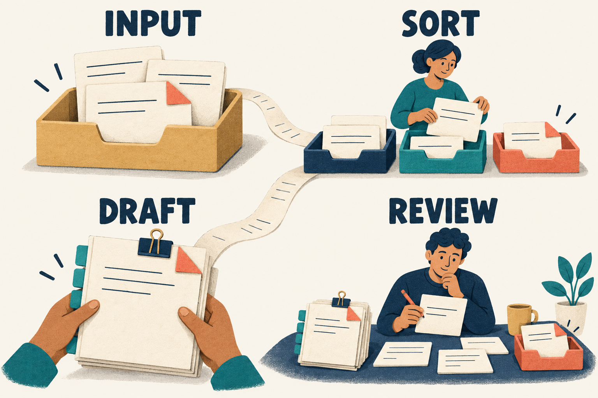
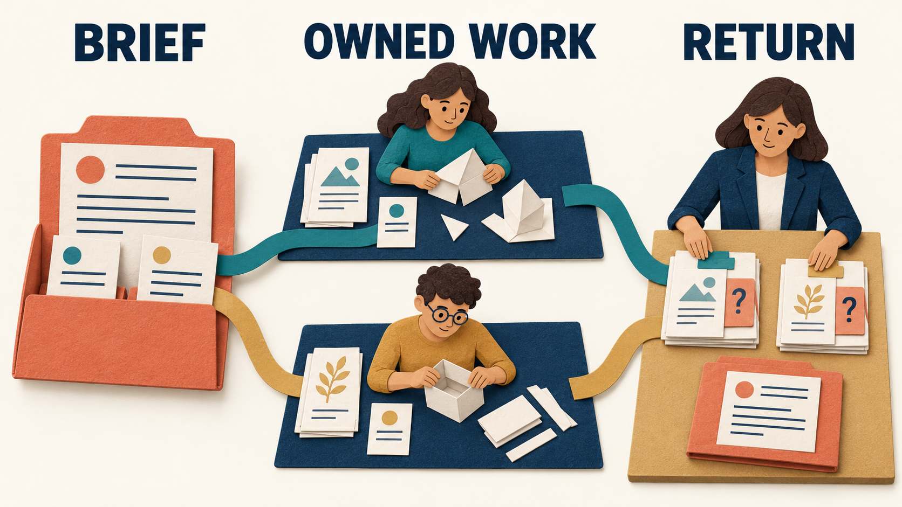
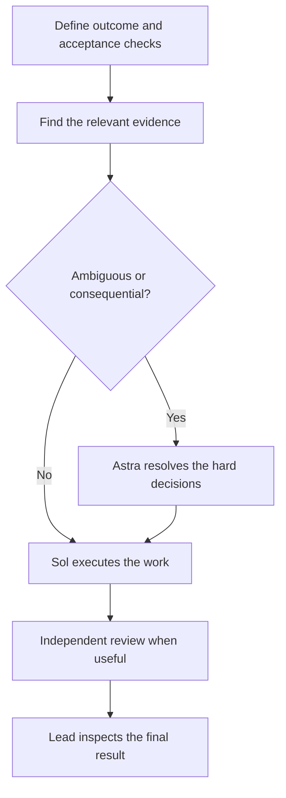

# ChatGPT Agent Team Guide

## Give AI a clear job. Get work you can check.

A visual, practical guide to **GPT-6.1 Sol, GPT-6 Astra and GPT-6 Luna**: choose a model, give each agent an owner and scope, and inspect the finished work.

<p align="center"></p>

**New to agents?** [Start here](docs/start-here.md) · **Running a business?** [Find a useful first workflow](docs/business-guide.md) · **Building software?** [Install the team](SETUP.md)

Inside: **9 reusable roles · 24 task choices · 12 workflow recipes · a recorded example · original artwork and reusable prompts.**

Independently maintained by [Dexter Ng at VYR](WORK_WITH_VYR.md). Product facts checked against [official sources](SOURCES.md) on **11 October 2026**. Routing choices are recommendations to evaluate on your work. This is not an OpenAI publication.

## Understand the team in 60 seconds

An **agent** is an AI worker with a job, instructions and access to particular tools. The **model** is the engine it uses. A **workflow** connects those jobs into a useful result.


| Job | What it does | What it returns |
|---|---|---|
| **Lead** | Defines the outcome, assigns work and makes the final decision | A completed result with its limits |
| **Find** | Reads the relevant files, records or sources | Evidence with traceable references |
| **Make** | Builds, writes or prepares the requested work | An artifact you can inspect |
| **Check** | Examines that artifact independently | Findings, checks and unresolved issues |

Start with one agent. Add a specialist when its contribution will change your next action. A role prompt alone does not select a model or launch separate agents; the product must support that behavior. [Official subagent configuration](https://learn.chatgpt.com/docs/agent-configuration/subagents).

## Choose a model by the work


| Work | Our starting choice | Example |
|---|---|---|
| Clear, bounded and easy to check | **GPT-6 Luna** | Extract fields or classify requests using explicit rules |
| Everyday execution with judgment | **GPT-6.1 Sol** | Implement a feature, research a brief or draft a proposal |
| Ambiguity or consequential decisions | **GPT-6 Astra** | Resolve conflicting evidence, design an architecture or audit access controls |

These starting choices follow the general positioning in [OpenAI’s model selection guide](https://developers.openai.com/api/docs/guides/model-selection). The task assignments and effort settings are our editorial choices, not measured comparisons.

Use **GPT-6.1 Sol / medium** as the everyday lead. [Pick from 24 tasks](docs/task-selector.md) · [Understand effort and access](docs/models-and-effort.md) · [Evaluate quality and cost](docs/cost-and-evaluation.md)

<details>
<summary><strong>See all nine reusable agent roles</strong></summary>

| Role | Model / effort | Expected return |
|---|---|---|
| [Architect](agents/guide_architect.toml) | Astra / high | Decisions, tradeoffs and acceptance checks |
| [Implementer](agents/guide_implementer.toml) | Sol 6.1 / medium | Changed files and verification |
| [Worker](agents/guide_worker.toml) | Luna / medium | One tightly specified task and its check |
| [Explorer](agents/guide_explorer.toml) | Luna / high | Paths, symbols and relevant evidence |
| [Reviewer](agents/guide_reviewer.toml) | Sol 6.1 / high | Reproducible findings from routine review |
| [Auditor](agents/guide_auditor.toml) | Astra / high | Consequential review and remaining uncertainty |
| [Researcher](agents/guide_researcher.toml) | Sol 6.1 / high | Sources, reconciled claims and unknowns |
| [Editor](agents/guide_editor.toml) | Sol 6.1 / medium | Clear writing grounded in verified material |
| [Visual director](agents/guide_visual_director.toml) | Sol 6.1 / medium | A visual brief, image-tool use and artifact review |

The files explicitly set model and effort. They do not grant model entitlement or tools. File settings take precedence over a conflicting role request. [Installation and model selection](SETUP.md#model-selection-precedence).

</details>

## See a business example from start to finish

Suppose your team receives support requests. An agent can read each request, prepare a category and a summary, and flag cases that need a person.



We ran **one scoped subagent on eight synthetic support requests** during this guide’s refresh. Expected routing was saved before the run. The input, prompt, actual output and checks are available for inspection.

| Request | Recorded result | Why a person is involved |
|---|---|---|
| Move an appointment to Thursday | Booking draft | A draft does not change the booking |
| “I was charged twice” | Billing review draft | Refunds need a decision |
| “I need help with it” | Clarification draft | The request does not identify the problem |

All eight recorded routes match this fixture’s expectations. That is a small inspectable demonstration, not a benchmark or a claim about accuracy on your customers. Every output remains a draft; no message, refund or account change was made.

**[Explore the complete example](examples/support-triage/README.md)** · [Input](examples/support-triage/input.json) · [Expected routes](examples/support-triage/expected.json) · [Actual output](examples/support-triage/recorded-output.json) · [Run record](examples/support-triage/run-record.json)

## Give every handoff an owner



Parallel work helps when the tasks are independent. Give each writable file, browser session or external record **one owner**. Keep dependent steps in order.

```text
Outcome: The result we need.
Context: The relevant sources and settled decisions.
Owner and scope: One agent; named files, questions or records.
Model and effort: Select them where the product supports it.
Acceptance: Observable checks that define completion.
Return: The artifact, evidence, checks and unresolved issues.
```



[Copy one of 12 workflow recipes](docs/workflows.md): features, hard bugs, research, proposals, data reconciliation, browser operations, refactors, creative work, document repair, support triage, audits and automation.

## Start in the product you actually use


| Surface | Start here |
|---|---|
| **Chat** | Use the brief and review habit in a conversation. Do not assume a role prompt creates a team. |
| **Work** | Use the models, tools and agent controls available in your account. |
| **Local Codex** | Install the reusable TOML definitions below. |
| **API** | Build orchestration in an application; check the distinction between SDK agents and native request subagents. |

GPT-6.1 Sol and Luna are listed for **Work and Codex**, subject to access, rather than ordinary Chat. [Official product availability](https://learn.chatgpt.com/docs/models) · [Product and API differences](docs/product-surfaces.md)

For a current local Codex client and Python 3.11+:

```bash
git clone https://github.com/dextee/chatgpt-agent-team-guide.git
cd chatgpt-agent-team-guide
python scripts/install_agents.py --project /path/to/your/project --dry-run
python scripts/install_agents.py --project /path/to/your/project
```

Then ask Codex:

```text
Use guide_explorer to map the code for this feature.
Give guide_implementer ownership of the change.
Ask guide_reviewer to inspect the result independently.
Keep requirements and final verification in the main thread.
```

The installer backs up changed destinations and leaves your main configuration alone. On Windows, use `py -3.12` if needed and quote paths with spaces. [Full setup, entitlement limits and rollback](SETUP.md).

## Make the evidence easy to inspect


A polished answer becomes useful evidence when another person can trace its claims and repeat its checks.

| Inspect | What it establishes |
|---|---|
| [Role map](config/role-map.json) and [agent files](agents/) | The shipped model and effort configuration |
| [Dated official sources](SOURCES.md) | Where product facts came from |
| [Recorded support example](examples/support-triage/README.md) | One actual synthetic run and its inspectable output |
| [Validation and limits](VALIDATION.md) | Checks performed and what they do not prove |
| [CI workflow](.github/workflows/validate.yml) | Repeatable checks configured for future pushes |
| [Image manifest and prompts](assets/README.md) | Artwork provenance, dimensions and file hashes |

Evaluate a representative sample of your own tasks before relying on a workflow. Include unclear requests and failure cases. Count review and rework as part of the work. [Evaluation worksheet](templates/evaluation.csv).

## Make images with the same discipline


Define the image’s teaching job, subject, composition, palette and exact text. Generate, inspect at the size people will see, then refine. Keep important instructions in accessible text alongside the picture.

For explicit API model selection, current official guidance positions **GPT Image 2.5 Sunburst** for demanding quality and **Flare** for fast exploration. [Official image prompting guidance](https://developers.openai.com/api/docs/guides/image-prompting).

This guide’s eight new illustrations used the **built-in image-generation tool**. Its backend model was not exposed, so their exact model identity is unverified. They are explanatory artwork rather than product screenshots or customer results.

**[Reuse the exact prompts](assets/new-prompts.json)** · [Follow the visual production recipe](docs/image-workflow.md) · [Browse the full gallery and provenance](assets/README.md)

## Put the method to work

[Try your first task](docs/start-here.md) · [Plan a business pilot](docs/business-guide.md) · [Report a reproducible correction](CONTRIBUTING.md)

For implementation help, [send a workflow brief to VYR](WORK_WITH_VYR.md). The [Agent OS showcase](https://github.com/dextee/vyr-agent-os-workflows) translates the method into business workflows. Review the [current LIVE, DEMO and BUILT FOR YOU statuses](https://vyrwork.com/agent-os) for their specific scope.

This educational guide is maintained alongside Dexter’s commercial work at VYR. The configurations and artwork do not establish customer outcomes or an OpenAI endorsement.

<details>
<summary>Coming from the Claude guide?</summary>

The Claude edition is live again as the **[Claude Code Agent Team Guide](https://github.com/dextee/claude-agent-team-guide)**, covering Fable 5.1, Opus 5.5, Sonnet 5.5 and Haiku 5.5. The original five-role pattern it started from remains at [its historical commit](https://github.com/dextee/vyr-agent-os-workflows/tree/d227750cba963e48eb38035d84c5d339c2d7f877). This guide researches OpenAI configuration independently. [Translation notes](docs/from-claude.md).

</details>
