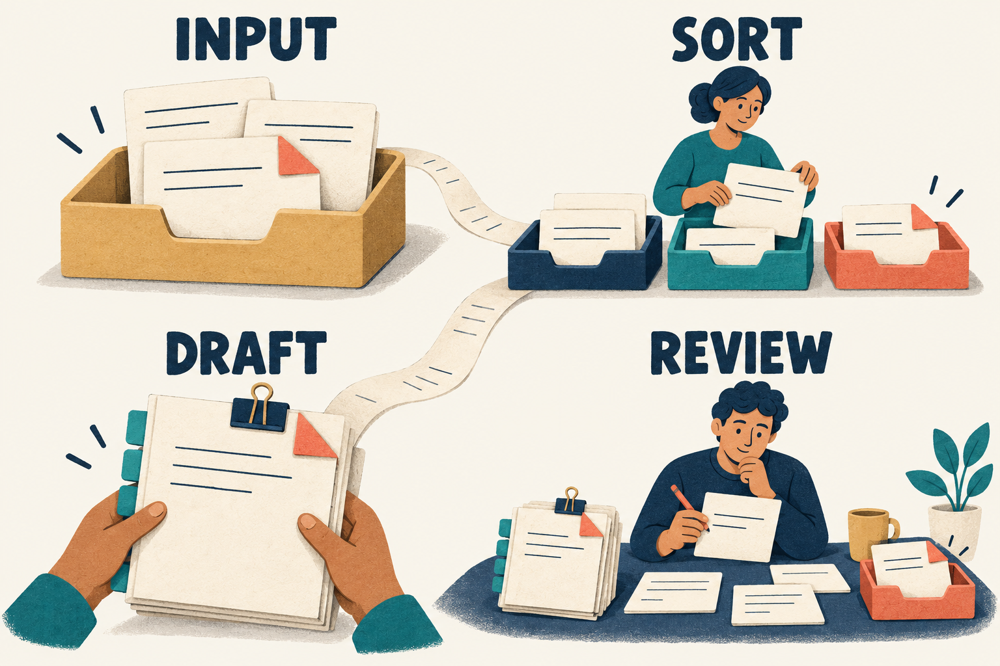
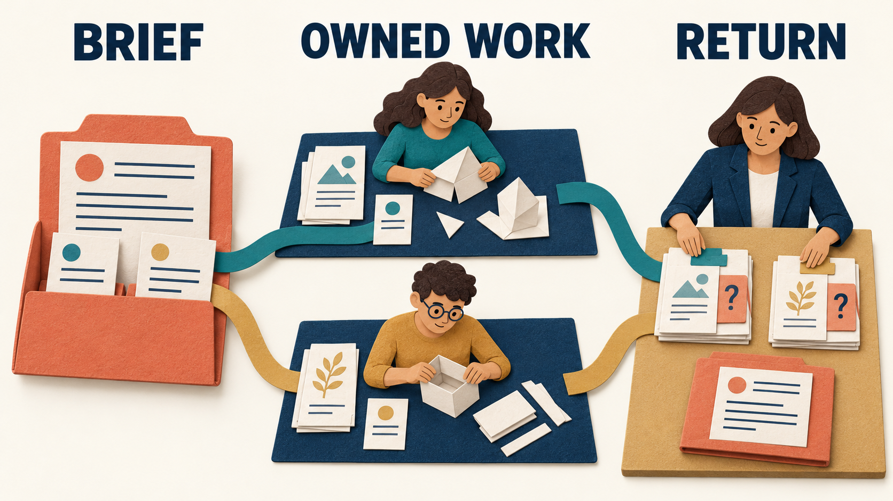
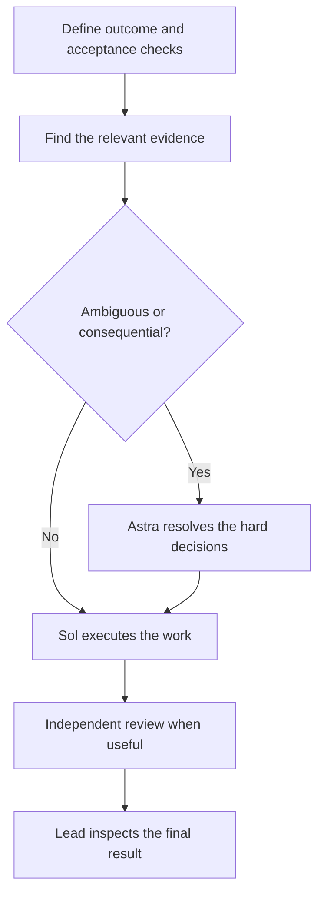

# ChatGPT Agent Team Guide

A practical guide to choosing a model, dividing work among agents and checking what they return. Start with **GPT-6.2 Sol** for everyday work. Try **GPT-6 Luna** for repeatable tasks, **GPT-6.1 Terra** for visual inspection and **GPT-6.2 Astra** for complex decisions.

| What do you want to do? | Start here |
|---|---|
| Try an agent in a conversation | [Turn a sample meeting note into a checked action list](docs/start-here.md) |
| Choose a model for a task | [Find your task among 24 recommendations](docs/task-selector.md) |
| Use a team in local Codex | [Install nine reusable roles](SETUP.md), then [choose a workflow](docs/workflows.md) |
| Test a business use case | [Inspect eight support drafts](examples/support-triage/README.md), then [design a pilot](docs/business-guide.md) |

<p align="center"></p>

An independent guide maintained by Dexter Ng at VYR. Product guidance reviewed on **20 November 2026**. Task assignments are the guide's recommendations. [Official sources](SOURCES.md) · [About the maintainer](WORK_WITH_VYR.md)

## Understand the team in 60 seconds

An **agent** is an AI worker with a job, instructions and access to particular tools. The **model** is the engine it uses. A **workflow** connects those jobs into a useful result.


| Job | What it does | What it returns |
|---|---|---|
| **Lead** | Defines the outcome, assigns work and makes the final decision | A completed result with its limits |
| **Find** | Reads the relevant files, records or sources | Evidence with traceable references |
| **Make** | Builds, writes or prepares the requested work | An artifact you can inspect |
| **Check** | Examines that artifact independently | Findings, checks and unresolved issues |

Start with one agent. Add a specialist when its contribution will change your next action. A role prompt alone does not select a model or launch separate agents; the product must support that behavior. [Official subagent configuration](https://learn.chatgpt.com/docs/agent-configuration/subagents).

## Choose a model by the work

| Work | Our starting choice | Example |
|---|---|---|
| Everyday execution with judgment | **GPT-6.2 Sol** | Implement a feature, research a brief or draft a proposal |
| Clear, bounded and easy to check | **GPT-6 Luna** | Extract fields or classify requests using explicit rules |
| A decision depends on what is visible | **GPT-6.1 Terra** | Read a chart, compare screenshots or verify the state of a desktop app with available tools |
| Complex work or consequential decisions | **GPT-6.2 Astra** | Resolve conflicting evidence, design an architecture or audit access controls |

Try Sol at **medium** reasoning effort for the lead. If a result needs rework, compare a different setting on the same input using the same acceptance checks. [OpenAI's Work and Codex model selection guide](https://learn.chatgpt.com/docs/model-selection) · [Evaluate quality and cost](docs/cost-and-evaluation.md)

[Pick from 24 tasks](docs/task-selector.md) · [Understand reasoning effort and model access](docs/models-and-effort.md)

<details>
<summary><strong>See all nine reusable agent roles</strong></summary>

| Role | Model / effort | Expected return |
|---|---|---|
| [Architect](agents/guide_architect.toml) | GPT-6.2 Astra / high | Decisions, tradeoffs and acceptance checks |
| [Implementer](agents/guide_implementer.toml) | GPT-6.2 Sol / medium | Changed files and verification |
| [Worker](agents/guide_worker.toml) | GPT-6 Luna / medium | One tightly specified task and its check |
| [Explorer](agents/guide_explorer.toml) | GPT-6 Luna / high | Paths, symbols and relevant evidence |
| [Reviewer](agents/guide_reviewer.toml) | GPT-6.2 Sol / high | Reproducible findings from routine review |
| [Auditor](agents/guide_auditor.toml) | GPT-6.2 Astra / high | Consequential review and remaining uncertainty |
| [Researcher](agents/guide_researcher.toml) | GPT-6.2 Sol / high | Sources, reconciled claims and unknowns |
| [Editor](agents/guide_editor.toml) | GPT-6.2 Sol / medium | Clear writing grounded in verified material |
| [Visual director](agents/guide_visual_director.toml) | GPT-6.1 Terra / medium | A visual brief and a review of the finished artwork, using a separate image tool for generation |

The files explicitly set model and effort. They do not grant model entitlement or tools. File settings take precedence over a conflicting role request. [Installation and model selection](SETUP.md#model-selection-precedence).

</details>

## See a business example from start to finish

Suppose your team receives support requests. An agent can read each request, prepare a category and a summary, and flag cases that need a person.



On **11 October 2026**, one subagent processed eight synthetic support requests. The maintainer recorded the expected routes beforehand. The run requested GPT-6 Luna at high effort. The runtime did not independently report the backend model.

| Request | Recorded result | Why a person is involved |
|---|---|---|
| Move an appointment to Thursday | Booking draft | A draft does not change the booking |
| “I was charged twice” | Billing review draft | Refunds need a decision |
| “I need help with it” | Clarification draft | The request does not identify the problem |

All eight drafts matched the expected category, next step and human-review flag. The result measures this one sample. You can recheck it offline from the repository root with `python scripts/check_demo.py`.

**[Explore the complete example](examples/support-triage/README.md)** · [Input](examples/support-triage/input.json) · [Expected routes](examples/support-triage/expected.json) · [Actual output](examples/support-triage/recorded-output.json) · [Run record](examples/support-triage/run-record.json)

## Give every handoff an owner



Parallel work helps when the tasks are independent. Give each writable file, browser session or external record **one owner**. Keep dependent steps in order.

```text
Outcome: The result we need.
Context: The relevant sources and settled decisions.
Owner and scope: One agent; named files, questions or records.
Model and effort: Select them where the product supports it.
Acceptance: Observable checks that define completion.
Return: The artifact, evidence, checks and unresolved issues.
```



The 12 recipes cover features, hard bugs, research, proposals, reconciliation, browser work, refactors, creative work, document repair, support triage, audits and automation. [Copy a workflow recipe](docs/workflows.md)

## Start in the product you actually use


| Surface | Start here |
|---|---|
| **Chat** | Paste the meeting-note exercise into a conversation and check its answer against the note. |
| **ChatGPT Work** | Pick an available model below the composer, request independent subtasks, then inspect their activity. |
| **Local Codex** | Install the role files below, open the target project and explicitly request one of the roles. |
| **API** | Choose the model in your application and decide how agents will share work. [Compare native subagents and SDK orchestration](docs/product-surfaces.md). |

OpenAI lists GPT-6.2 Sol and Astra for supported ChatGPT Work accounts and the Codex app and CLI. For the IDE extension, check the model picker before installing pinned roles. GPT-6.1 Sol is a documented cross-client choice. [Official product availability](https://learn.chatgpt.com/docs/models) · [Product and API differences](docs/product-surfaces.md)

For the CLI quick start, use Git, Python 3.11 or later and Codex CLI **0.166.0 or later** for the GPT-6.2 roles. Replace `/path/to/your/project` with the path to the project where you use Codex. Preview the destinations before installing. [OpenAI client requirements](https://help.openai.com/en/articles/20001275-chatgpt-work-and-codex)

```bash
codex --version
git clone https://github.com/dextee/chatgpt-agent-team-guide.git
cd chatgpt-agent-team-guide
python scripts/install_agents.py --project /path/to/your/project --dry-run
python scripts/install_agents.py --project /path/to/your/project
```

Open the target project in a new Codex session. Select read-only permissions on the parent session for this first check.

```text
Spawn guide_explorer to find the main entry point in this project.
Ask it to return the file path and a line that shows where execution starts.
Leave the files as they are. Wait for the explorer and show its evidence.
```

Inspect the child activity and open the cited file. On Windows, use `py -3.12` if needed and quote paths with spaces. [Full setup, model access and rollback](SETUP.md).

## Make the evidence easy to inspect


A polished answer becomes useful evidence when another person can trace its claims and repeat its checks.

| Inspect | What it establishes |
|---|---|
| [Role map](config/role-map.json) and [agent files](agents/) | The shipped model and effort configuration |
| [Dated official sources](SOURCES.md) | Where product facts came from |
| [Recorded support example](examples/support-triage/README.md) | One actual synthetic run and its inspectable output |
| [Validation and limits](VALIDATION.md) | Checks performed and what they do not prove |
| [CI workflow](.github/workflows/validate.yml) | Repeatable checks configured for future pushes |
| [Image manifest and prompts](assets/README.md) | Artwork provenance, dimensions and file hashes |

Evaluate a representative sample of your own tasks before relying on a workflow. Include unclear requests and failure cases. Count review and rework as part of the work. [Evaluation worksheet](templates/evaluation.csv).

## Make images with the same discipline


Define the image’s teaching job, subject, composition, palette and exact text. Generate, inspect at the size people will see, then refine. Keep important instructions in accessible text alongside the picture.

For new Image API work, use **GPT-Image-2.6 Flare** to explore quickly or **GPT-Image-2.6 Sunburst** when the composition or edit needs fine detail. The visual director reviews the result using its own model. [Official image prompting guidance](https://developers.openai.com/api/docs/guides/image-prompting)

The eight October illustrations came from a built-in image-generation tool that did not report its backend model. The gallery preserves those originals and the nine September illustrations.

**[Reuse the exact prompts](assets/new-prompts.json)** · [Follow the visual production recipe](docs/image-workflow.md) · [Browse the full gallery and provenance](assets/README.md)

## Put the method to work

[Try your first task](docs/start-here.md) · [Plan a business pilot](docs/business-guide.md) · [Report a reproducible correction](CONTRIBUTING.md)

For implementation help, [send a workflow brief to VYR](WORK_WITH_VYR.md). The [Agent OS showcase](https://github.com/dextee/vyr-agent-os-workflows) translates the method into business workflows. Review the [current LIVE, DEMO and BUILT FOR YOU statuses](https://vyrwork.com/agent-os) for their specific scope.

This educational guide is maintained alongside Dexter’s commercial work at VYR. The configurations and artwork do not establish customer outcomes or an OpenAI endorsement.

<details>
<summary>Coming from the Claude guide?</summary>

The Claude edition is live again as the **[Claude Code Agent Team Guide](https://github.com/dextee/claude-agent-team-guide)**, covering Fable 5.1, Opus 5.5, Sonnet 5.5 and Haiku 5.5. The original five-role pattern it started from remains at [its historical commit](https://github.com/dextee/vyr-agent-os-workflows/tree/d227750cba963e48eb38035d84c5d339c2d7f877). This guide researches OpenAI configuration independently. [Translation notes](docs/from-claude.md).

</details>
