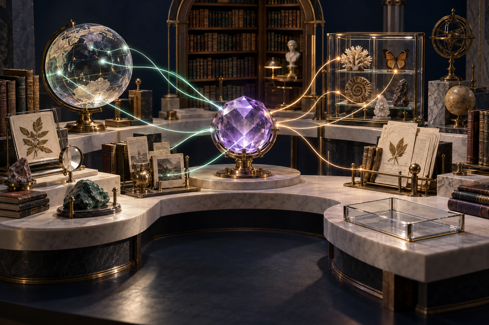
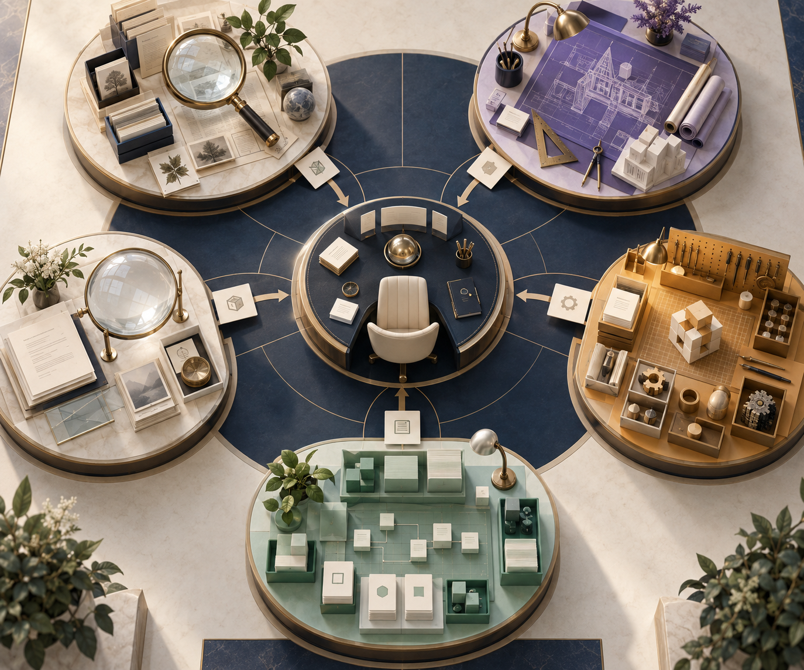
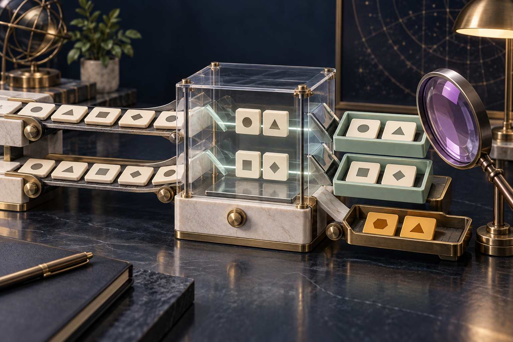
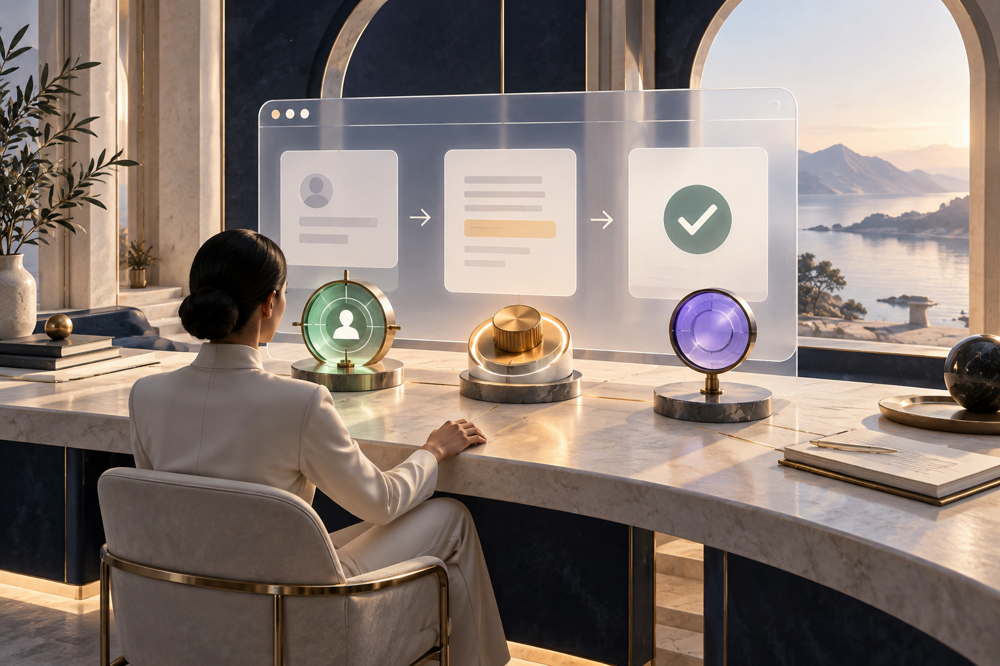
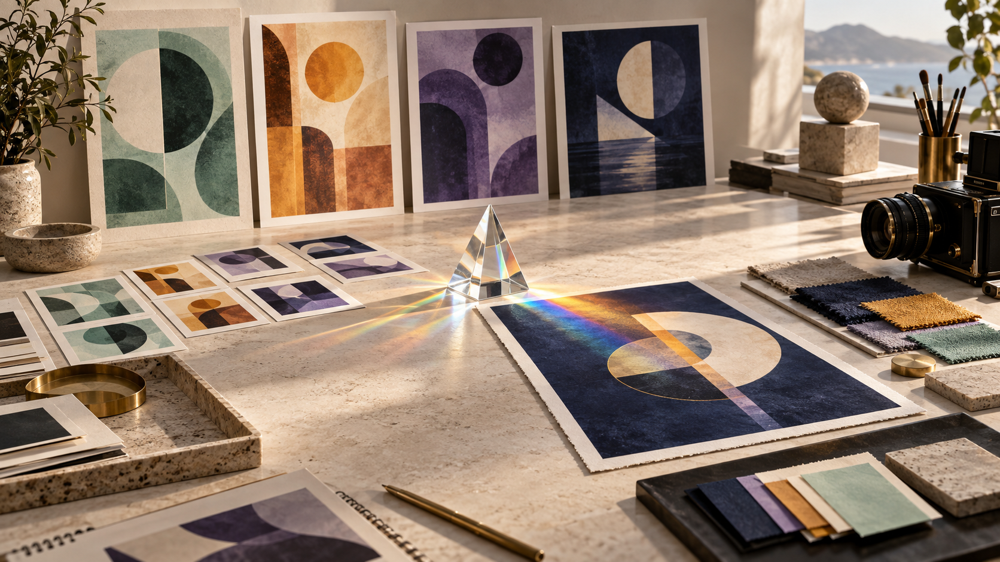
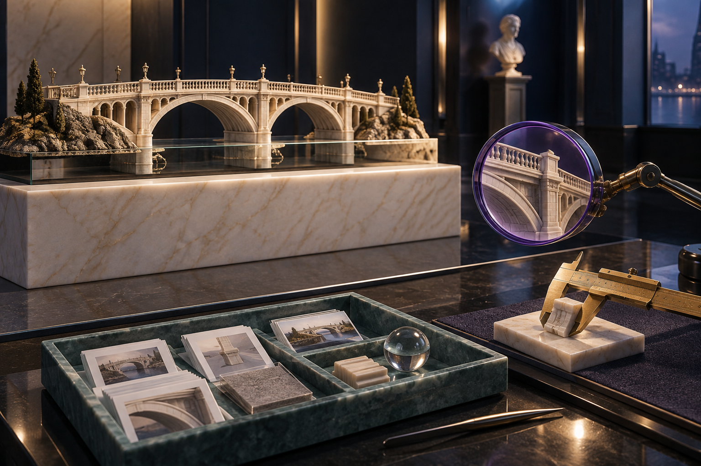

# Artwork gallery and provenance

[Home](../README.md) · [Image workflow](../docs/image-workflow.md)

Seventeen illustrations created for this guide: eight new teaching illustrations on 11 October 2026 and nine original images from 29 September 2026. The method was **built-in image generation**; the exact backend model is **unknown**. These assets are not claimed as verified GPT Image 2.5 outputs.

## The working brief — October collection

This collection uses warm ivory, navy, teal, coral and ochre, with tactile paper and human worktables. Each picture explains one concept. The accompanying guide text carries the meaning independently of the artwork.

| Concept | Illustration |
|---|---|
| One brief becomes reviewed work |  |
| Four complementary jobs |  |
| Choose by the work |  |
| A business workflow |  |
| Owned handoffs |  |
| Distinct product surfaces |  |
| Inspectable evidence |  |
| Visual production |  |

[Exact October prompts](new-prompts.json) preserve the actual generation instructions. Images were inspected for composition, intended meaning and label spelling. Labels also appear in accessible Markdown; generated text is not the sole source of any instruction.

## Original September collection

The visual language uses ivory, midnight navy, glass and brass, with mint for focused work, amber for execution and violet for deeper reasoning. These are conceptual metaphors, not product screenshots or capability measurements.

| Team and model choice | Work in practice |
|---|---|
|  |  |
|  |  |
|  |  |
|  |  |
|  | Each image has a defined role in the guide. |

See [image-manifest.json](image-manifest.json) for prompts, dimensions, content hashes and inspection status. Original generation outputs were copied into the repository without claiming a backend model that the tool did not expose.
