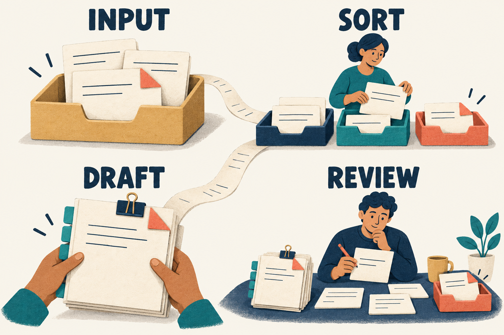

# Choose an agent workflow your business can evaluate

[Home](../README.md) · [First task](start-here.md) · [Implementation with VYR](../WORK_WITH_VYR.md)

Start with one recurring task, its inputs and the result a person can inspect. Define what the agent may prepare and who owns the next action.



## Look for a useful first task

| Process | Work an agent could prepare | Decision a person still owns |
|---|---|---|
| Support inbox | Categories, summaries and response drafts | Sending replies, refunds and account changes |
| Prospect research | Sourced company notes and qualification drafts | Contact strategy and approving outreach |
| Proposals | A draft based on approved scope and pricing | Commercial commitments |
| Weekly reporting | A summary linked to underlying records | Interpreting exceptions and acting on them |

These are candidate use cases. Their value depends on your sources, access, operating rules and evaluation.

In the October support example, the request “I need help with it” went to clarification because no category could be inferred. A duplicate charge went to billing review. Both outputs were drafts. Compare the policy with the saved routes before designing your own. [Inspect the recorded example](../examples/support-triage/README.md)

## Define a pilot before adding a large team

1. **Choose the task.** Name its owner, frequency, current tools and typical exceptions.
2. **Record a baseline.** Observe how the task is completed today, including review and rework.
3. **Define access.** List the approved sources and distinguish read access from actions.
4. **Write acceptance checks.** Decide how to detect invented facts, incorrect routing, missing evidence and unfinished work.
5. **Test representative cases.** Include ambiguous inputs, duplicates, missing information and failed integrations.
6. **Review the result.** Compare the completed work and total effort with the baseline before expanding.

For a support pilot, have someone label a fresh set of tickets before running the agent. Agree which requests must go to a person. After the run, count missed escalations and measure how long people spent correcting the drafts. Compare total handling time per accepted ticket with the baseline. A time saving is useful only if the agreed escalation and quality criteria also pass. [Evaluation worksheet](../templates/evaluation.csv)

## Distinguish a useful draft from an operating system

| Stage | Evidence to inspect |
|---|---|
| Draft preparation | Output traces to approved inputs; uncertainty is visible |
| Connected workflow | Permissions, ownership and data handling are defined |
| Operational release | Approval, recovery, duplicate prevention and monitoring work in realistic cases |
| Business outcome | Results measured after release against an agreed baseline |

For outreach, review suppression, unsubscribe handling, sender readiness and duplicate prevention before considering sending. A generated email alone does not establish an operational outreach system.

## Give an implementation team a useful brief

```text
Task and business owner:
Current steps and tools:
Typical volume and exceptions:
Approved sources:
Actions that require human approval:
Result and acceptance checks:
Baseline to compare:
Budget range and target start:
```

[Discuss a scoped implementation with VYR](../WORK_WITH_VYR.md) · [Inspect current Agent OS workflow status](https://vyrwork.com/agent-os)

This guide is maintained alongside VYR’s commercial work. Sample data, illustrations and model recommendations do not establish customer results.
