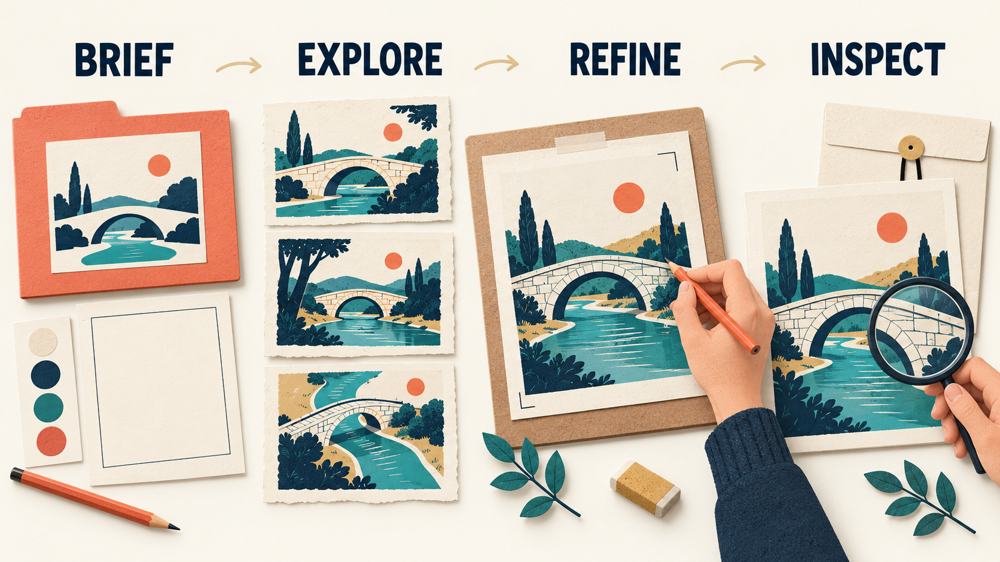

# Make useful, coherent images

[Home](../README.md) · [Artwork gallery](../assets/README.md)



## Pick the image tool deliberately

For a new Image API workflow, start with **GPT-Image-2.6 Flare** (`gpt-image-2.6-flare`) for quick variations. Choose **GPT-Image-2.6 Sunburst** (`gpt-image-2.6-sunburst`) when an edit must preserve small details or meet a precise layout. The installable visual director uses GPT-6.1 Terra to prepare the brief and inspect the result. A separate image tool produces the image. [Image generation](https://developers.openai.com/api/docs/guides/image-generation) · [Model and prompting guidance](https://developers.openai.com/api/docs/guides/image-prompting)

In some product tools the backend model is not exposed. Record the tool used and leave the exact model unknown. Do not infer model provenance from image quality or the wording of a prompt.

## The visual-director brief

```text
Asset and use: [README hero, slide, product photo, illustration]
Audience and message: [who it is for and what it should convey]
Subject: [concrete scene and required objects]
Composition: [framing, aspect ratio, useful negative space]
Style: [medium, lighting, palette and materials]
Exact copy: [only if words must appear]
Invariants: [identity, geometry, brand details or elements to preserve]
Avoid: [known unwanted elements]
Acceptance: [visual checks and required output files]
```

Create a small set of distinct directions, choose one, then refine specific issues. Use consistent palette, materials and composition across a package. Inspect text at its actual display size and review important details against references.

For diagrams with exact labels or quantitative charts, use deterministic drawing or plotting tools. This guide uses generated illustrations for atmosphere and Mermaid for the exact workflow relationship.

## A production prompt you can adapt

```text
Create a landscape editorial teaching illustration for a coordinated AI team.
Show a lead worktable receiving evidence from three separate stations:
a magnifying lens over source pages, hands making a paper prototype,
and a reviewer comparing the result with a checklist.
Keep each job distinct and the scene legible at small display sizes.

Art direction: tactile cut paper, navy pen contours and restrained shadows.
Warm ivory #F7F3EA, navy #172F40, teal #147B77, coral #E56F52,
muted ochre #DDB76F. Matte paper, painted wood and calm daylight.
Composition: wide framing and generous margins. No generated words,
logos, fake product screens or performance claims.
Preserve the same materials, palette and worktable identities in variants.
Deliver a clean opaque image; inspect object edges and the intended crop.
```

After choosing a direction, name the precise edit: “Move the making station right to open the title area; preserve the other worktables, palette, lighting and camera angle.” Compare the original and revision at the intended display size. Add accurate labels in the document layout when exact text matters. The [October prompt collection](../assets/new-prompts.json) records the exact instructions used for this guide.

## Explicit API selection

These examples were checked against the API documentation on **20 November 2026**. Running either makes a billed request. Use a current OpenAI Python SDK, an API project with the required model access and an `OPENAI_API_KEY` environment variable. [Generation guide](https://developers.openai.com/api/docs/guides/image-generation)

For a single image, select the 2.6 model directly with the Image API.

```python
import base64
from pathlib import Path
from openai import OpenAI

client = OpenAI()
output = Path("team-concept-sunburst.png")
if output.exists():
    raise FileExistsError(output)
result = client.images.generate(
    model="gpt-image-2.6-sunburst",
    prompt="An editorial ivory-and-glass diorama of a lead worktable and three "
           "specialist stations in mint, amber and violet. Midnight navy backdrop. "
           "Wide composition, empty title area on the left. No text or logos.",
    size="1536x1024",
    quality="high",
    background="opaque",
    output_format="png",
)
with output.open("xb") as file:
    file.write(base64.b64decode(result.data[0].b64_json))
```

To compare speed and quality, change the model to `gpt-image-2.6-flare` and use a new output filename. Keep the prompt, dimensions and rendering quality fixed. Inspect both images at their intended display size and record how long each took. [Prompting guidance](https://developers.openai.com/api/docs/guides/image-prompting)

For a conversation, the Responses API takes a main model and an image tool. OpenAI's documented example selects **GPT-6.2 Astra** for the request and **GPT Image 2.5 Sunburst** inside the tool. Use the Image API example above when you need the 2.6 image model explicitly. [Responses image-generation example](https://developers.openai.com/api/docs/guides/image-generation)

```python
import base64
from pathlib import Path
from openai import OpenAI

client = OpenAI()
output = Path("team-concept-response.png")
if output.exists():
    raise FileExistsError(output)
response = client.responses.create(
    model="gpt-6.2-astra",
    input="Generate an ivory-and-glass editorial diorama of a central lead "
          "and three distinct specialist workstations. No text or logos.",
    tools=[{"type": "image_generation", "model": "gpt-image-2.5-sunburst"}],
)
images = [item.result for item in response.output
          if item.type == "image_generation_call"]
if not images:
    raise RuntimeError("The response did not return a generated image")
with output.open("xb") as file:
    file.write(base64.b64decode(images[0]))
```

## This repository's artwork

The September and October generation records identify the built-in tool but leave its backend model unknown. Use the manifest to check each original's filename, dimensions, inspection record and hash. [Artwork manifest](../assets/image-manifest.json)
